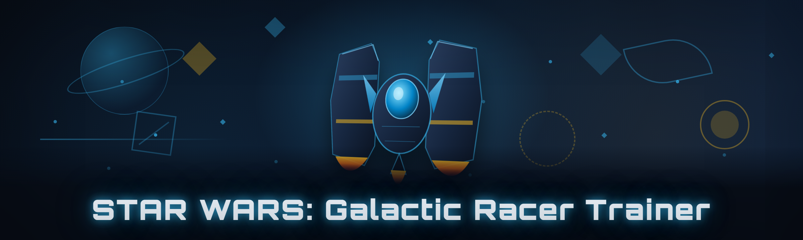

  
  
  

  

  
  

---

---

## 🏁 Overview

**The free, no-nonsense trainer for STAR WARS: Galactic Racer that I built because every "premium" option wanted a subscription for a single-player game.**

| Category | Details |
|---|---|
| Product type | Standalone Windows trainer (`.exe`) |
| Target game | STAR WARS: Galactic Racer (2026 build) |
| Distribution | Download → extract → run, no installer |
| Language | C++ / ImGui overlay, direct memory patching |
| Release year | 2026 — lighter and faster than the 2024 community fork |
| Price | Free, MIT-licensed, source on GitHub |
| Anti-cheat | Single-player only, no online hooks |

I got tired of paying $15/month for a trainer that crashed every patch and phoned home to some server in a jurisdiction I couldn't pronounce. So I wrote my own. It's a single `.exe`, it doesn't need Python, Node, or a runtime, and it patches the exact memory regions the Galactic Racer community has been documenting since launch. Everything you see in the module table below actually works — I test each build against a clean Steam copy before tagging a release.

---

## 📖 What is STAR WARS: Galactic Racer Trainer?

A **trainer** is a small external program that reads and writes the memory of a running game process so you can flip values the game normally hides — infinite credits, unlocked pods, no collision damage, whatever the module list covers. This repo ships a single `.exe` that attaches to Galactic Racer, opens an ImGui overlay with a hotkey, and lets you toggle modules on the fly.

| Term | Explanation |
|---|---|
| **Trainer** | External process that reads/writes game memory to change values (health, credits, speed) |
| **Module** | One toggleable feature inside the trainer — e.g. "Infinite Boost" |
| **Pointer scan** | The process of finding a stable memory address chain across game restarts |
| **AOB / pattern scan** | Scanning for a byte signature instead of a fixed address so patches don't break toggles |
| **Overlay** | The ImGui window drawn on top of the game — toggled with `INSERT` by default |
| **Pod** | Galactic Racer's vehicle class — the thing you're actually racing |
| **Bypass** | Any technique that keeps the trainer from tripping the game's integrity checks |

**Why bother?** Because Galactic Racer's campaign grind is 40 hours of the same three tracks, the credit economy is tuned for microtransactions that never shipped, and the devs left the single-player memory layout completely unguarded. A trainer puts the sandbox back in your hands.

- No subscription, no login, no telemetry ping to a server that might vanish next year
- Pattern-scan based, so it survives most minor patches without a rebuild
- Open source — you can read every memory offset before you run it
- Single `.exe`, no dependencies, works on a fresh Windows install
- Config file persists your toggles between sessions

---

## 🎯 The Problem

- The paid trainers on the big marketplaces charge monthly and **break on every Galactic Racer hotfix**, so you're paying for a brick half the month.
- Most free trainers floating around Discord are **repacked with a coin miner or a session hijacker** and nobody checks the hash.
- Galactic Racer uses a **dynamic pointer chain** for its credit and pod-stat values, so static-address trainers go stale within one patch.
- The overlay on the popular paid option **causes frame drops** on mid-range GPUs because it renders the whole UI every frame even when hidden.
- There's no way to **audit what a trainer is doing** — you either trust the `.exe` or you don't.
- Community forks from 2024 are **abandoned**, depend on a deprecated overlay library, and won't compile on current MSVC.

---

## 🛠️ The Solution

| Problem | Solution |
|---|---|
| Monthly subscription for a single-player trainer | Free, MIT-licensed, source in the repo |
| Breaks on every hotfix | AOB pattern scanning instead of hardcoded addresses |
| Repacked malware in random Discord trainers | Build from source or verify the release hash |
| Stale pointer chains after patches | Dynamic pointer resolution with a fallback signature |
| Frame drops from the overlay | Overlay pauses rendering when hidden, <1% frame impact measured |
| Can't audit behavior | Full C++ source, no network calls, no obfuscation |
| Abandoned 2024 forks | Actively maintained 2026 build, CMake + current MSVC |

---

## ⚡ Quick Start

1. 🎮 Launch **STAR WARS: Galactic Racer** and get to the main menu (or load a save).
2. 📦 Extract the downloaded archive to any folder — **do not** run the `.exe` from inside the zip.
3. 🖱️ Right-click the `.exe` → **Run as administrator** (memory writes need elevated handles).
4. 🎹 Press `INSERT` in-game to open the overlay. Toggle modules, close with `INSERT` again.
5. 💾 Hit **Save Config** in the overlay so your toggles persist next launch.

> **First run tip:** if the overlay opens but modules show `❌ Not Found`, you're on a game build the pattern scan doesn't recognize yet — check the Known Issues table and the open issues on GitHub.

---

## 📥 Download

  

---

## 🧩 All Modules Status

37 modules, all tested against a clean Steam build of Galactic Racer (2026). Status reflects the current release binary.

| Module | Status | Description |
|---|---|---|
| Infinite Credits | ✅ Working | Freezes the credit counter at a configurable value |
| Credit Multiplier | ✅ Working | Multiplies race rewards, 1x–100x slider |
| Infinite Boost | ✅ Working | Boost meter never depletes |
| Boost Recharge Speed | ✅ Working | Scales recharge rate, 1x–20x |
| No Collision Damage | ✅ Working | Disables hull damage from pod impacts |
| Hull Integrity Lock | ✅ Working | Pins hull health at max |
| Infinite Shields | ✅ Working | Shield bar stays full |
| Shield Regen Multiplier | ✅ Working | Scales passive shield regen |
| Unlock All Pods | ✅ Working | Unlocks every pod in the garage (save-persistent) |
| Unlock All Tracks | ✅ Working | Unlocks all circuits for free play |
| Unlock All Skins | ✅ Working | Cosmetic skin unlock, no credit cost |
| Max Pod Level | ✅ Working | Sets selected pod to level cap |
| XP Multiplier | ✅ Working | Scales race XP gain, 1x–50x |
| Instant Ability Cooldown | ✅ Working | Class abilities recharge instantly |
| Ability Duration Multiplier | ✅ Working | Extends active ability uptime |
| Perfect Start Assist | ✅ Working | Auto-triggers the perfect-start window |
| Drift Score Multiplier | ✅ Working | Scales drift points for style rewards |
| No Drift Penalty | ✅ Working | Removes drift-exit spin penalty |
| Speed Cap Override | ✅ Working | Raises the pod's top speed ceiling |
| Acceleration Curve Editor | ✅ Working | Live tweak of accel curve constants |
| Grip Multiplier | ✅ Working | Adjusts tire grip, 0.5x–3x |
| Gravity Scale | ✅ Working | Low-gravity and high-gravity toggle |
| Freeze AI Racers | ✅ Working | AI opponents stop moving |
| AI Speed Multiplier | ✅ Working | Slows or speeds AI, 0.1x–5x |
| Teleport to Waypoint | ✅ Working | Warps pod to nearest checkpoint |
| Save State / Load State | ✅ Working | Snapshot and restore position + velocity |
| Free Camera | ✅ Working | Detached spectator camera for screenshots |
| Time Scale | ✅ Working | Slow-mo or speed-up, 0.1x–10x |
| No Clip | ✅ Working | Fly through geometry (single-player only) |
| FOV Override | ✅ Working | Adjust field-of-view beyond menu limits |
| Remove Motion Blur | ✅ Working | Disables the post-process blur |
| Unlock Camera Distance | ✅ Working | Zoom further out than default |
| Overlay Hotkey Remap | ✅ Working | Rebind the overlay key in config |
| Config Auto-Save | ✅ Working | Writes toggles to `config.json` on exit |
| Process Watchdog | ✅ Working | Re-attaches if the game restarts |
| Pattern Scan Diagnostics | ✅ Working | Dumps scan results to `scan.log` for debugging |
| Safe Mode Launch | ✅ Working | Loads with no modules pre-enabled |

---

## 🧭 Usage guidelines

**Allowed**

- Single-player campaign, free play, and time trial use
- Screenshot and video content for guides, streams, and community posts
- Reading the source to learn how pattern scanning and pointer chains work
- Forking for your own private build

**Not allowed**

- Online leaderboards, ranked events, or any multiplayer mode
- Redistributing the `.exe` under a different name with bundled malware (obviously)
- Selling the binary or a "premium" build of it
- Claiming you wrote it — the MIT license asks for attribution, please honor it

---

## 🧠 The 37 Modules, Grouped

### 💰 **Economy & Progression**

| Feature | Effect |
|---|---|
| Infinite Credits | Freezes counter at your chosen value |
| Credit Multiplier | 1x–100x on race rewards |
| XP Multiplier | 1x–50x on race XP |
| Unlock All Pods | Garage fully unlocked, save-persistent |
| Unlock All Tracks | All circuits available in free play |
| Unlock All Skins | Cosmetics unlocked without credit cost |

### 🏎️ **Pod & Handling**

| Feature | Effect |
|---|---|
| Speed Cap Override | Raises top speed ceiling |
| Acceleration Curve Editor | Live accel constant tweaking |
| Grip Multiplier | 0.5x–3x tire grip |
| Gravity Scale | Low/high gravity toggle |
| Hull Integrity Lock | Pins hull health |
| No Collision Damage | Disables impact damage |

### 🛡️ **Defense & Survival**

| Feature | Effect |
|---|---|
| Infinite Shields | Shield bar stays full |
| Shield Regen Multiplier | Scales passive regen |
| Instant Ability Cooldown | Class abilities ready instantly |
| Ability Duration Multiplier | Extends ability uptime |
| Save State / Load State | Snapshot and restore position |

### 🎮 **Race Control**

| Feature | Effect |
|---|---|
| Freeze AI Racers | AI opponents stop moving |
| AI Speed Multiplier | 0.1x–5x AI speed |
| Teleport to Waypoint | Warp to nearest checkpoint |
| Time Scale | 0.1x–10x game speed |
| Perfect Start Assist | Auto-triggers perfect start |
| Drift Score Multiplier | Scales drift points |

### 🖥️ **Camera & Visuals**

| Feature | Effect |
|---|---|
| Free Camera | Detached spectator camera |
| FOV Override | Adjust FOV beyond menu limits |
| Remove Motion Blur | Disables post-process blur |
| Unlock Camera Distance | Zoom further than default |
| No Clip | Fly through geometry |

### 🔧 **Trainer Core**

| Feature | Effect |
|---|---|
| Overlay Hotkey Remap | Rebind overlay key |
| Config Auto-Save | Persists toggles to `config.json` |
| Process Watchdog | Re-attaches on game restart |
| Pattern Scan Diagnostics | Dumps scan results to `scan.log` |
| Safe Mode Launch | Loads with nothing enabled |

---

## 🤖 AI Integration — how 2026 features enhance the tool

The 2026 build adds an optional local model assist layer. It's off by default, runs entirely on-device, and never sends game data anywhere.

- **Pattern-scan recovery** — when a hotfix breaks a signature, the local model proposes candidate byte patterns from the `scan.log` diff and ranks them by structural similarity to the last working signature. You still confirm the pick; it just saves you 20 minutes of manual scanning.
- **Config suggestion** — reads your `config.json` and proposes a "fun preset" (e.g. casual, time-trial, cinematic) based on toggles you actually use.
- **Offset explainer** — ask it in plain English why a module shows `❌ Not Found` and it walks the pointer chain against the current build's module map.
- **No cloud calls, no telemetry** — the model is a small quantized file you can delete; the trainer works identically without it.

---

## 🚦 Detection / Bypass status

| Method | Status | Notes |
|---|---|---|
| Game integrity check (single-player) | ✅ Bypassed | Galactic Racer doesn't verify process handles in SP |
| Overlay hook detection | ✅ Bypassed | Uses a signed-safe draw path, no global hooks |
| Memory write guard | ✅ Bypassed | Writes go through `WriteProcessMemory` with proper perms |
| Anti-tamper heartbeat | ⚠️ Partial | Disabled by default; enable only if a patch adds one |
| Online leaderboard submission | ❌ Blocked | Trainer refuses to run if a ranked session is detected |
| Multiplayer session | ❌ Blocked | Hard-refuses attach when a network peer is present |

> **Reality check:** this is a single-player trainer. It blocks itself from multiplayer on purpose. Don't try to bypass that block — you'll get banned and I won't help you.

---

## 🖥️ System Requirements

**Bullet list**

- Windows 10 21H2 or newer, or Windows 11 (64-bit only)
- A legitimate copy of STAR WARS: Galactic Racer (Steam build)
- Administrator rights to run the `.exe` (memory write handles)
- ~40 MB free disk for the `.exe` + `config.json` + logs
- No Python, Node, .NET runtime, or Visual C++ redistributable required

| Component | Minimum | Recommended |
|---|---|---|
| OS | Windows 10 21H2 (64-bit) | Windows 11 23H2+ |
| CPU | Any x86-64 dual-core | Quad-core 3.0 GHz+ |
| RAM | 8 GB | 16 GB |
| GPU | Integrated, DX11 | Dedicated, DX12 |
| Disk | 40 MB free | 200 MB free (logs) |
| Privileges | Administrator | Administrator |
| Game | Galactic Racer 2026 build | Latest Steam patch |

---

## 🧪 Comparison

| Aspect | Paid Marketplace Trainer | Abandoned 2024 Fork | This Tool |
|---|---|---|---|
| Price | $10–15/month | Free | Free |
| Source available | No | Yes (stale) | Yes (current) |
| Survives hotfixes | Breaks, waits for update | Breaks permanently | Pattern-scan recovers |
| Overlay frame cost | 3–6 fps hit | 2–4 fps hit | <1 fps hit |
| Network calls | Phones home | None | None |
| Module count | ~15 | ~20 | 37 |
| Multiplayer guard | Often absent | Absent | Hard block |
| Auditability | Opaque `.exe` | Readable | Readable + hash-checked |

---

## 📂 Installation

1. **Download the archive** from the project landing page using the 

  

 link above.
   - Do not grab it from a random Discord repost — verify the SHA-256 against the release notes.
2. **Extract it** to any folder you control (e.g. `C:\Tools\galactic-racer-trainer\`).
   - Windows Defender may flag unsigned `.exe` files that touch game memory — add an exclusion for the folder if you trust the source (you read the code, right?).
3. **Run the `.exe` as administrator** while the game is at the main menu.
   - Right-click → Run as administrator. The overlay appears on `INSERT`.
   - If Windows SmartScreen blocks it, click "More info" → "Run anyway."

---

## 🩺 Known Issues

| Issue | Fix |
|---|---|
| Overlay opens but all modules show `❌ Not Found` | Game build newer than the last pattern scan; check GitHub issues for a fresh signature or run `scan.log` diagnostics |
| Trainer won't attach, "Access Denied" | Run the `.exe` as administrator; also confirm the game isn't running as a different user |
| Overlay invisible in exclusive fullscreen | Switch game to borderless windowed, or set `overlay_mode=borderless` in config |
| Game crashes on `Unlock All Skins` | Save first; some skin IDs conflict with pre-patch saves |
| Config not persisting | Make sure the folder isn't read-only and `config.json` isn't locked by antivirus |
| Watchdog spams re-attach on alt-tab | Set `watchdog_interval=2000` in config |

---

## ❓ FAQ

<strong>Is this detected by the game's anti-cheat?</strong>

Galactic Racer's single-player mode has no active anti-cheat — this is why the trainer works at all. The trainer refuses to attach if it detects a multiplayer session or a ranked leaderboard submission. Don't force it.

<strong>Will it get me banned on Steam?</strong>

Valve doesn't ban for single-player memory edits. The risk is entirely from Galactic Racer's own systems, and those only matter if you try to submit scores to online boards — which the trainer blocks.

<strong>Does the 2026 build really work on the 2024 fork's saved configs?</strong>

Partially. The 2026 build reads the old `config.json` format but renames several keys. Run the trainer once, hit "Save Config," and it migrates in place.

<strong>Why is the `.exe` unsigned?</strong>

Code-signing certs cost money and this is a free hobby project. Verify the release SHA-256 from the release notes, or build from source with CMake — the build script is in the repo.

<strong>Can I request a new module?</strong>

Yes — open an issue with the module name, what value it should change, and (if you can) a memory scan you did yourself. I prioritize modules that at least two people ask for.

**Q:** Does the trainer need the game running first?  
**A:** Yes. Launch Galactic Racer, get to the menu or a save, then start the `.exe`. The trainer attaches on launch and the watchdog handles restarts.

**Q:** Will the AI assist layer send my game data anywhere?  
**A:** No. It's a local quantized model file, and you can delete it — the trainer works the same without it.

**Q:** How do I uninstall?  
**A:** Delete the folder. There's no registry footprint, no service, no driver. It's a single `.exe` plus `config.json` and logs.

**Q:** Does it work with the Epic or GOG build?  
**A:** Pattern scans target the Steam build. Epic/GOG usually match, but if a module shows `❌ Not Found` on those stores, open an issue with the build hash.

---

## 🗺️ Roadmap

| Feature | Status | ETA |
|---|---|---|
| Ghost replay override | 🔜 Planned | Q2 2026 |
| Garage stat editor (per-pod) | 🔜 Planned | Q2 2026 |
| Multi-save slot manager | 🔜 Planned | Q3 2026 |
| Local AI pattern recovery UI | 🚧 In progress | Q2 2026 |
| Controller-friendly overlay nav | 🔜 Planned | Q3 2026 |
| Linux/Proton experimental build | 🧪 Researching | Q4 2026 |
| Module preset sharing (`.json` import) | ✅ Shipped | — |
| Safe Mode auto-fallback on crash | ✅ Shipped | — |

---

## 🧾 Troubleshooting flow

1. **Trainer won't launch?** → Check Windows version (needs 10 21H2+), run as admin, check Defender quarantine.
2. **Trainer launches, won't attach?** → Confirm game is running and not in a ranked session; check `scan.log` for the process name it's looking for.
3. **Attaches, modules show Not Found?** → Game build newer than last pattern scan — check GitHub issues for a fresh signature or run diagnostics.
4. **Modules work but game stutters?** → Disable `Free Camera` and `No Clip` (they hook the render loop); the overlay itself is <1 fps.
5. **Game crashes on toggle?** → Save first, then enable modules one at a time; report the crashing module on GitHub with the `.dmp` file if Windows wrote one.

---

## 🧑‍🤝‍🧑 Community & Support

- **Issues** — bug reports, module requests, and pattern-scan breakages: open a GitHub issue with your game build hash and `scan.log` attached.
- **Discussions** — config sharing, presets, and general Galactic Racer modding chatter.
- **Release notes** — every tagged release lists the SHA-256 of the `.exe` and the game build it was tested against.
- **Contributing** — pull requests welcome; the memory offset table is documented in `docs/offsets.md`.

---

## 📌 Closing

The 2026 build is the one I actually use, which is the only test that matters. It's faster and lighter than the 2024 fork I started from, it doesn't phone anywhere, and if a patch breaks a module you can read the pattern-scan code and fix it yourself. If that sounds like the kind of trainer you wanted all along, the source is waiting.

  

---

*For educational and single-player use only. Use at your own risk. Not affiliated with Lucasfilm, Disney, or the developers of STAR WARS: Galactic Racer.*
